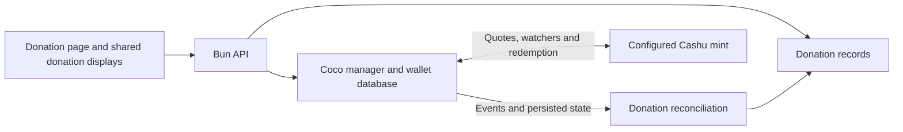

# Coco donation backend research and implementation plan

Coco can handle invoice creation, mint payment observation, ecash issuance, and wallet recovery inside a small persistent Bun service. Nut November still needs durable donation records, an HTTP contract, idempotency, and reconciliation between Coco state and public totals. The mint issues the Lightning invoice and holds the underlying Lightning funds; our service owns the resulting Cashu wallet and donation application.

## Agreed scope

Use Bun with two SQLite databases: Coco owns `/data/coco.sqlite`, and Drizzle owns `/data/app.sqlite` for application persistence. The configured production mint is `https://mint.minibits.cash/Bitcoin` with `sat`/`bolt11` payments. Keep anonymous donations and optional Nostr signing for verified donor identity. Start with an empty donation ledger; existing Nostr donation history and legacy receipts will not be imported or included in new totals. The frontend adds the 400,000-sat sponsor commitment and computes prize allocations. The backend reports actual confirmed donations and their sum only.

The selected mint's public information advertises BOLT11/sat minting from 1 to 1,000,000 sats, WebSocket mint-quote subscriptions, and NUT-20 quote ownership support. Use those advertised limits as the initial validation bounds and check capabilities again during runtime integration. This metadata does not establish tested payment, WebSocket, or recovery behavior. [Minibits mint information](https://mint.minibits.cash/Bitcoin/v1/info).

Implementation check on 2026-10-24: `/v1/keysets` returned an active compatible sat keyset (`01fc0ec0e59cd6fa01b7a88f8cd77fce81fd1e64bca67d752e984992b7a3c3a821`). Using the pinned packages on Bun 1.3.14, a live smoke check created a locked 21-sat BOLT11 quote, prepared its operation, closed both Coco and SQLite, and recovered the same invoice and pending operation after reopening. No funds were sent. Actual paid issuance and WebSocket/polling failover still need a controlled launch rehearsal. [Mint keysets](https://mint.minibits.cash/Bitcoin/v1/keysets).

## Verified release and runtime

As of 2026-10-24, the latest official stable GitHub release is **Coco v2.0.0**, published 2026-08-17 at commit `7dada8305be1c0a1e6b1ecaa9d53a91c5686771c`. The APIs below were checked against that tag, rather than unreleased `master`. Both `@cashu/coco-core` and `@cashu/coco-sqlite-bun` are version `2.0.0`; core depends on `@cashu/cashu-ts@5.0.0-rc.4`. These packages are ESM-only. The release explicitly excludes BLS v3 keysets and tokens, so the selected mint needs a compatible keyset. [Release](https://github.com/cashubtc/coco/releases/tag/v2.0.0), [core package](https://github.com/cashubtc/coco/blob/v2.0.0/packages/core/package.json), [Bun adapter package](https://github.com/cashubtc/coco/blob/v2.0.0/packages/sqlite-bun/package.json).

The implementation pins both Coco packages to 2.0.0 in `server/package.json` and commits `server/bun.lock`. Package resolution and installation succeeded against npm during implementation, and the installed APIs were used in the live unpaid-invoice smoke check.

The Bun adapter accepts an already-open `bun:sqlite` database. `initializeCoco()` calls `repo.init()`, initializes plugins, enables watchers and processors by default, and runs recovery before returning. The application owns database closure. The seed provider must return the same **64-byte `Uint8Array`** across restarts. [Bun adapter](https://github.com/cashubtc/coco/blob/v2.0.0/packages/sqlite-bun/README.md), [initialization](https://github.com/cashubtc/coco/blob/v2.0.0/packages/core/Manager.ts#L181), [seed validation](https://github.com/cashubtc/coco/blob/v2.0.0/packages/core/services/SeedService.ts).

## Exact invoice flow

Version 2 uses **quote creation followed by operation preparation**. An invoice comes from `manager.quotes.mint.create()`. Preparing the quote persists deterministic output data and gives the wallet a recoverable mint operation. Both returned objects expose `request`, the BOLT11 invoice. [Minting guide](https://github.com/cashubtc/coco/blob/v2.0.0/packages/docs/starting/minting.md), [quote API](https://github.com/cashubtc/coco/blob/v2.0.0/packages/core/api/QuoteApi.ts), [operation API](https://github.com/cashubtc/coco/blob/v2.0.0/packages/core/api/MintOpsApi.ts).

API sketch, with application persistence and HTTP handling deliberately left to the integration plan:

```ts
import { initializeCoco } from '@cashu/coco-core';
import { SqliteRepositories } from '@cashu/coco-sqlite-bun';
import { Database } from 'bun:sqlite';

const mintUrl = process.env.MINT_URL!;
const seed = new Uint8Array(Buffer.from(process.env.COCO_SEED_HEX!, 'hex'));
if (seed.length !== 64) throw new Error('Expected a persistent 64-byte seed');

const database = new Database('/data/coco.sqlite');
const manager = await initializeCoco({
  repo: new SqliteRepositories({ database }),
  seedGetter: async () => seed,
});
await manager.mint.addMint(mintUrl, { trusted: true });

// Register global operation listeners and reconcile persisted donations here.
// Persist our donation intent and idempotency key before creating its quote.
const amountSats = 1_000;
const quote = await manager.quotes.mint.create({
  mintUrl,
  method: 'bolt11',
  unit: 'sat',
  amount: amountSats,
  // locked: true, // Optional NUT-20; see the compatibility notes below.
});

// Persist quote.mintUrl + quote.quoteId + quote.request on our donation first.
const operation = await manager.ops.mint.prepare({ quote, amount: amountSats });
// Persist operation.id, then re-read/project its current state before responding.
// Return only our private status reference, operation.request, amount and expiry.
```

`prepare()` accepts only `{ quote, amount }`: no caller-provided operation ID, arbitrary metadata, message, or public `init()` stage. Its internal operation ID is generated by Coco. Fixed BOLT11 quotes reject a second operation, so retry recovery should call `listByQuote({ mintUrl, quoteId })` before preparing again. A crashed internal `init` operation is removed by startup recovery. BOLT11 quote creation also has no description/message field in this release; the donation message belongs in our own table. [Public inputs](https://github.com/cashubtc/coco/blob/v2.0.0/packages/core/api/MintOpsApi.ts#L12), [private preparation and duplicate protection](https://github.com/cashubtc/coco/blob/v2.0.0/packages/core/operations/mint/MintOperationService.ts#L136), [quote inputs](https://github.com/cashubtc/coco/blob/v2.0.0/packages/core/api/QuoteApi.ts#L12).

## Watchers and payment meaning

The default mint watcher observes trusted mints, including existing pending operations and quotes at startup. The processor claims paid quotes automatically. Bun's global WebSocket is detected automatically; hybrid transport keeps polling as a backup, normally every 20 seconds, switching to a 5-second interval when WebSocket fails. Polling-only operation is available when no WebSocket implementation exists. These are backend-to-mint intervals, independent of browser polling. [Watcher implementation](https://github.com/cashubtc/coco/blob/v2.0.0/packages/core/services/watchers/MintOperationWatcherService.ts), [manager transport configuration](https://github.com/cashubtc/coco/blob/v2.0.0/packages/core/Manager.ts#L804), [hybrid transport](https://github.com/cashubtc/coco/blob/v2.0.0/packages/core/infra/HybridTransport.ts).

The relevant events are:

| Event | Payload | Application meaning |
| --- | --- | --- |
| `mint-quote:updated` | `{ mintUrl, method, quoteId, quote }` | Canonical quote payment/accounting changed; also emitted at creation. |
| `mint-op:pending` | `{ mintUrl, operationId, operation }` | Prepared, or returned to pending during recovery. |
| `mint-op:executing` | same operation envelope | Redemption or recovery is running. |
| `mint-op:finalized` | same operation envelope | Terminal issued operation; inspect `operation.error`. |
| `mint-op:failed` | same operation envelope | Terminal operation failure; inspect `terminalFailure`. |

`manager.on()` returns an unsubscribe function. Quote updates are saved before emission; operation changes are likewise saved before their events. Event handlers run sequentially by default and their errors are caught and logged. The bus is an in-memory listener map, without a durable delivery queue or replay. [Event types](https://github.com/cashubtc/coco/blob/v2.0.0/packages/core/events/types.ts#L73), [event bus](https://github.com/cashubtc/coco/blob/v2.0.0/packages/core/events/EventBus.ts), [quote persistence](https://github.com/cashubtc/coco/blob/v2.0.0/packages/core/quotes/QuoteLifecycle.ts#L478), [operation persistence](https://github.com/cashubtc/coco/blob/v2.0.0/packages/core/operations/mint/MintOperationService.ts#L304).

Keep payment and issuance separate. BOLT11 quotes expose `amountPaid` and `amountIssued`; the legacy `UNPAID` / `PAID` / `ISSUED` state is a deprecated compatibility projection. A paid invoice can still await ecash redemption. A normal `finalized` operation has saved or recovered outputs. However, the v2 `ALREADY_ISSUED` branch can finalize **without recoverable proofs**, setting `operation.error`. Therefore use `finalized && !error` for ordinary successful collection, and put finalized-with-error into an operator review state. A payer whose payment was observed must not be instructed to pay again because wallet recovery failed. [Quote accounting](https://github.com/cashubtc/coco/blob/v2.0.0/packages/core/models/MintQuote.ts), [issuance and exceptional finalization](https://github.com/cashubtc/coco/blob/v2.0.0/packages/core/operations/mint/MintOperationService.ts#L434).

Coco amounts are `Amount` values. Convert only explicit, validated public amount fields to the application's bounded satoshi integer/string representation; never return or JSON-serialize whole operations. Operations include deterministic output material, while repository storage includes bearer proofs and private keys. [Operation model](https://github.com/cashubtc/coco/blob/v2.0.0/packages/core/operations/mint/MintOperation.ts), [storage security](https://github.com/cashubtc/coco/blob/v2.0.0/packages/docs/pages/storage-adapters.md#security).

## HTTP idempotency and reconciliation

Recommended application sequence:

1. Validate the request and optional Nostr identity proof, then atomically reserve a donation row under a unique idempotency key; reject reuse with different amount/message/verified-identity parameters. Serialize concurrent attempts for that row.
2. Create the Coco quote, then persist its private mint URL/quote ID, invoice, amount and expiry onto the donation row.
3. Find an existing operation for that quote or prepare it; save its operation ID.
4. Re-read the operation and project its current state into the donation row, then return the already-persisted public response.
5. On a retry, resume from the stored stage and return the same invoice. Do not generate a replacement invoice merely because the first HTTP response was lost.

The quote-to-row mapping comes before `prepare()` because `mint-op:pending` is emitted before `prepare()` resolves. Early callbacks can match by private `{ mintUrl, quoteId }`, and the final re-read closes a callback race. A crash between remote quote creation and recording its application association can leave an orphan unpaid quote; the public APIs do not provide remote quote-creation idempotency. No invoice should reach the browser until its association is durable. Avoid wrapping network calls in a long SQLite transaction. [Preparation order](https://github.com/cashubtc/coco/blob/v2.0.0/packages/core/operations/mint/MintOperationService.ts#L224), [quote creation order](https://github.com/cashubtc/coco/blob/v2.0.0/packages/core/quotes/QuoteLifecycle.ts#L478).

Use events to trigger idempotent state projection, with a startup scan and periodic reconciliation of application donation rows. `initializeCoco()` can finish an operation before application listeners are attached, and a crash or failing listener can leave an already-finalized operation absent from application totals. Reconciliation must include donations still marked pending in our database even when Coco no longer lists their operations as pending. Compute totals from durable successful donation rows; never increment a total for each callback, and never use current wallet balance as cumulative donations.

Relevant supported reads/actions are `ops.mint.get(id)`, `listByQuote({ mintUrl, quoteId })`, `listPending()`, `listInFlight()`, `refresh(id)`, `finalize(id)`, and `recovery.run()`. Canonical quote reads are `quotes.mint.get(...)`, `refresh(...)`, and `listPending(...)`. `refresh()` can perform remote checks and recovery; use `get()` for routine browser status requests against local state. Keep remote repair work bounded and outside the request path. [Operation API](https://github.com/cashubtc/coco/blob/v2.0.0/packages/core/api/MintOpsApi.ts), [quote API](https://github.com/cashubtc/coco/blob/v2.0.0/packages/core/api/QuoteApi.ts).

Automatic processing is not an unlimited retry guarantee. The queue defaults to three network retries; the direct quote-claim path catches errors without enqueuing an indefinite retry, and unchanged quote observations need not emit another update. Reconciliation should explicitly retry stalled paid/pending or executing operations with backoff, record failures, and alert on repeated inability to collect. [Processor defaults and error handling](https://github.com/cashubtc/coco/blob/v2.0.0/packages/core/services/watchers/MintOperationProcessor.ts), [suppression of unchanged quote events](https://github.com/cashubtc/coco/blob/v2.0.0/packages/core/quotes/QuoteLifecycle.ts#L1511).

For an internal funds audit, `repositories.proofRepository.getProofsByOperationId(mintUrl, operationId)` exists on the supported adapter contract. It returns input or output associations, so filter by `createdByOperationId` when examining collected outputs. `manager.wallet.balances` provides aggregate balances rather than per-donation receipts. Application success records should survive later spending of those proofs. [Proof repository contract](https://github.com/cashubtc/coco/blob/v2.0.0/packages/core/repositories/index.ts#L56).

## Expiry and deployment constraints

Quote expiry is advisory for issuance. In v2, claimability deliberately ignores expiry; an unpaid expired quote can remain pending and watched, and late observed payment must still be collected. The documentation's state-table example suggesting expiry always produces `failed` is broader than the implementation. Model invoice expiry as an application presentation state that can later advance to payment received; do not delete wallet recovery data or make expiry an irreversible payment verdict. Treat `null` and zero expiry as no finite quote deadline. Some mint error responses during execution can still cause terminal failure. [Claimability implementation](https://github.com/cashubtc/coco/blob/v2.0.0/packages/core/models/MintQuoteClaimability.ts), [BOLT11 recovery](https://github.com/cashubtc/coco/blob/v2.0.0/packages/core/infra/handlers/mint/MintBolt11Handler.ts), [NUT-04 expiry semantics](https://github.com/cashubtc/nuts/blob/main/04.md).

Because abandoned invoices remain wallet work, bound invoice creation and concurrent pending donations from the outset. The public mint operation API has no cancel/delete method. Larger long-term deployments need an explicit abandoned-quote retention/watch policy; it should preserve paid-quote recovery. [Mint API surface](https://github.com/cashubtc/coco/blob/v2.0.0/packages/core/api/MintOpsApi.ts), [watcher startup scans](https://github.com/cashubtc/coco/blob/v2.0.0/packages/core/services/watchers/MintOperationWatcherService.ts).

Keep the mint quote ID server-side. NUT-04 warns that exposing an unlocked quote ID can allow another party to redeem it. Expose an unrelated opaque application ID/status capability plus the BOLT11 invoice. Optional `locked: true` uses NUT-20 ownership and requires mint support. Stable v2 notes a concurrent quote-key allocation race; if enabling locks, serialize quote creation in the single wallet process and verify concurrent/restart behavior before launch. [NUT-04 quote secrecy](https://github.com/cashubtc/nuts/blob/main/04.md), [locked quote implementation](https://github.com/cashubtc/coco/blob/v2.0.0/packages/core/infra/handlers/mint/MintBolt11Handler.ts#L33), [key allocation](https://github.com/cashubtc/coco/blob/v2.0.0/packages/core/services/KeyRingService.ts#L41).

Use one long-lived wallet process with a persistent local volume and stable secret configuration. The source's operation/counter locks are in-process, so a second active process against the same wallet requires separate coordination and is outside this minimal design. Back up the seed, Coco database, donation metadata, and SQLite journals consistently. Coco's adapters do not encrypt wallet storage. During shutdown, stop accepting requests, drain handlers and reconciliation, call `await manager.dispose()`, then close the database. [Shared in-process locking](https://github.com/cashubtc/coco/blob/v2.0.0/packages/core/Manager.ts), [storage responsibilities](https://github.com/cashubtc/coco/blob/v2.0.0/packages/docs/pages/storage-adapters.md), [disposal](https://github.com/cashubtc/coco/blob/v2.0.0/packages/core/Manager.ts#L430).

Before launch, validate the selected mint's BOLT11/sat support and amount limits, compatible keysets, WebSocket/polling behavior, successful issuance and recovery, and NUT-20 if selected. Exercise restarts before payment, during issuance, and after Coco finalization but before our donation projection; duplicate HTTP requests; interrupted responses; a lost event; transient mint failure; and late/expired payments. The sketch above is planning material; the implemented adapter is in `server/src/wallet.ts`. Initialization, quote creation and restart recovery were exercised against Minibits. No live payment was performed.

## Original Nut November behavior

Before this migration, the donation page signed a Nostr zap request, asked `npubx.cash` for an invoice, and waited for a zap receipt. Separately, DonationsContext and the donation store collected verified receipts from relays to build the history, counts, pool total, and prize allocations. The implementation replaces both parts with the API while preserving optional Nostr identity signing.

The original store filtered legacy receipts from 2026-01-01 onward; the replacement starts from an empty backend ledger instead. Keep the frontend's 400,000-sat sponsor commitment allocated 150,000 / 100,000 / 50,000 / 50,000 / 50,000 across the five prizes, with each prize receiving `floor(donationTotal / 5)` additional sats. The frontend derives `total = 400_000 + donationTotal`; the API and database contain no synthetic sponsor donation. Track any division remainder without silently changing that allocation. Messages unlock strictly above 1,000 sats, accept at most 280 UTF-16 code units, and display at most 256 Unicode code points. New donation history sorts by amount descending, then time descending, then stable ID. [Accounting and sorting](../src/app/lib/donations.ts), [message policy](../src/app/lib/donationMessages.ts).

Nostr continues to verify optional donor identity and also handles [project submissions](../src/actions/nostr.ts) and participation links. Keep `nostr-tools`; payment success and donation totals come from Coco and our ledger.

## Proposed service and API

Add a private `server/` Bun package in this repository, with its own dependencies, lockfile, TypeScript configuration, tests, Dockerfile, and Fly configuration. Keep its runtime types outside the Next.js TypeScript/build scope; the root configuration currently includes every TypeScript file. Extract only pure donation types and policy into a shared module if both applications need them. A small `Bun.serve` router is sufficient for these routes. [Current TypeScript scope](../tsconfig.json), [Bun routing](https://bun.com/docs/runtime/http/server).



Run one manager for the process lifetime. Use `/data/coco.sqlite` for Coco and `/data/app.sqlite` for Drizzle-managed application records, each with its own `bun:sqlite` connection on the same persistent volume. Coco owns its migrations; Drizzle owns application migrations and never models or modifies Coco tables. This also keeps Drizzle outside Coco's private transaction queue. The staged creation and reconciliation described above bridge the two databases. Configure `https://mint.minibits.cash/Bitcoin` as the trusted mint and `sat`/`bolt11` on the server. The request cannot choose an arbitrary mint, currency, payment method, or recipient. [Coco transaction implementation](https://github.com/cashubtc/coco/blob/v2.0.0/packages/sqlite-bun/src/db.ts), [Drizzle Bun SQLite integration](https://orm.drizzle.team/docs/sqlite/connect-bun-sqlite).

| Endpoint | Contract |
| --- | --- |
| `POST /donate` | JSON `{ requestId, amountSats, message? }`, where `requestId` is a client-generated idempotency key, plus optional NIP-98 authorization for donor identity. Return a private donation status reference, `invoice`, `amountSats`, `expiresAt`, and `status` after durable creation. Use `201` for creation, `200` for an existing ready request, `202` for a still-running creation, and `409` for key reuse with different amount/message/identity. |
| `GET /donate/:id` | Read persisted status using an unpredictable private status reference. Return the stored invoice for refresh/resume, its amount/deadline, and payment/collection status. Set `Cache-Control: no-store`. |
| `GET /donations` | Return the current campaign's confirmed donations and a consistent snapshot of `donationCount` and `donationTotal`, excluding sponsorship. Public items contain a separate public ID, amount, public message preview, timestamp, and optional verified `donorPubkey`. The frontend adds sponsorship and computes pool/prize totals. |
| `GET /healthz` and `GET /readyz` | Process liveness and initialized database/manager readiness. Record mint connectivity separately so a temporary mint outage does not trigger endless process restarts. |

Use integer sats, `Number.isSafeInteger`, and a configured minimum/maximum compatible with the chosen mint. Enforce message rules on the server, limit request size, and rate-limit creation plus outstanding invoices. Allow the production web origins and explicit local development origins through CORS, including preflight for JSON and `Authorization`. CORS is separate from abuse limits. Return sanitized upstream errors; keep authorization headers, private status references, invoices, quote IDs, seed material, proofs and internal operation objects out of public history and logs.

This deployment has a single fresh campaign ledger. The donation record needs a private status reference, public ID, unique idempotency key and normalized request hash, amount, message, optional verified donor pubkey and signed-request evidence, lifecycle state, creation/payment/confirmation timestamps, private quote identity, operation ID, invoice and expiry, and last reconciliation error. Apply uniqueness constraints to the operation association and signed-event replay mapping. No legacy receipt schema or import path is needed. Use short Drizzle transactions for application mutations, and serialize concurrent requests sharing one idempotency key. Generate a fresh key for a deliberately new donation, retaining the old key across network retries.

Expose the distinction between `pending`, `paid` (received, collection still underway), and `confirmed` (normal successful Coco finalization). Also represent creation, operator review, and definite failure. Invoice expiration is a separate display condition; it must allow later observed payment to advance the record. Only confirmed records contribute to public totals. Once payment is known, show that it was received even if collection needs attention, with no instruction to pay again. Already-issued operations carrying an error go to review.

Install one set of global Coco listeners. Each callback requests a projection from current persisted Coco state; avoid blindly applying an older callback payload over newer state. Run the same projection after creation, at startup, and periodically for unresolved application rows, with bounded repair attempts for stalled paid operations. Preserve monotonic confirmed accounting and reconcile from application records, not only Coco's pending list. Compute the public list and aggregates from one consistent application database read.

For the first version, poll our status endpoint roughly every two seconds while an invoice is active, backing off on errors and resuming on page focus. Refresh shared totals every 15–30 seconds while visible and immediately after payment confirmation. This reads local backend state; Coco alone manages normal mint observation. Store the active donation reference in session storage to resume after refresh, and retain a versioned local cache for public snapshots. An SSE endpoint can be added if measured latency needs justify it; it is not required for correctness.

## Optional verified donor identity

Retain the existing Anonymous / My Nostr profile choice. Anonymous requests have no identity authorization and no stored donor pubkey. Profile donations use the NIP-07 browser signer to sign a NIP-98 HTTP authentication event for `POST https://api.nutnovember.org/donate`. Send it as `Authorization: Nostr <base64-event>`. Require the signed `payload` tag to contain SHA-256 of the exact request body, including `requestId`, amount and message. The identity proof stays between the browser and backend; no relay publication or zap receipt is needed. [NIP-07 browser signing](https://github.com/nostr-protocol/nips/blob/master/07.md), [NIP-98 HTTP authentication](https://github.com/nostr-protocol/nips/blob/master/98.md).

Before creating an invoice, verify the event ID and signature, kind 27235, empty content, a timestamp within 60 seconds of server time, exact configured public URL, method POST, and body hash. Require exactly one matching URL, method and payload tag. Derive identity only from the verified event pubkey. Return 401 for malformed or invalid supplied authorization rather than silently treating it as anonymous. Bind idempotency to the normalized amount/message and verified pubkey; fresh signatures for retries may vary in timestamp but cannot change the donor. A signed event must not authorize a second donation with a different request ID. Include signature tampering, changed body/URL/method, stale/future events, replay and identity-changing retries in tests. Requiring the body hash is this endpoint's policy; NIP-98 recommends it for requests with bodies.

Verification proves that the donation request was signed by the holder of that Nostr key. It does not identify the Lightning wallet that subsequently pays the invoice. Coco independently establishes payment/collection status. Only confirmed donations expose their optional verified pubkey in the public feed; the UI must explain that profile attribution and the message will be public on this site.

## Frontend cutover

Replace the zap-building and LNURL request in [donate/page.tsx](../src/app/donate/page.tsx) with the API client and optional NIP-98 signing described above. Keep the identity selector and extension signing UI, with explicit handling for rejection or an unavailable signer. Replace `useReceiptSubscription` with status polling. Reuse the QR, copy, wallet-link and thank-you components, adding expiration and received-but-processing states. Identity signing cannot determine payment success.

Replace the relay adapter in `DonationsContext` and the receipt-driven store with a shared API snapshot store. Keep the `DonationData` boundary so Hero, Sponsors, Prizes, the donate page and donation history all continue reading the same data. Derive pool total and prize allocations in this frontend layer from the API's donation-only aggregates and the existing sponsor constants. Replace cached snapshots from the server instead of permanently merging old client entries; server corrections must propagate. Change the cache namespace and ignore the old signed-receipt cache entirely. Show cached new-ledger values as stale during outages instead of reporting zero donations. Update the remaining payment copy and metadata that say “zap” or “public on Nostr.”

Start with zero backend donations and zero backend donation total. The initial frontend pool is therefore 400,000 sats, supplied entirely by its sponsor constants. Preserve no historical Nostr donations, import no receipts, and run no legacy catch-up job. The new donation history page shows donations collected through the new backend only.

At cutover, stop generating new legacy invoices and switch donation history and totals to the new ledger. Any payment to a legacy invoice or the old address remains outside these new totals. Keep the new backend running for already-issued Coco invoices even if the frontend is rolled back.

## Deployment and delivery sequence

The current web app already uses Fly, but its [configuration](../fly.toml) has no persistent volume and its [Docker image](../Dockerfile) runs Node/Next.js. Deploy the API as a separate Fly app at `api.nutnovember.org`, with a Bun image, TLS, a mounted `/data` volume, one active wallet process, and `auto_stop_machines = "off"`. Keep the existing frontend deployment independent and add scoped API CI/deployment configuration. Fly volumes are local to one machine and are not automatically replicated, so this choice accepts brief deployment or host-recovery downtime. [Fly volume behavior](https://fly.io/docs/volumes/overview/), [Fly configuration](https://fly.io/docs/reference/configuration/).

Persist a validated seed as a secret and fail startup if it is absent or malformed. Record enough wallet identity metadata to detect accidentally starting an existing database with a different seed. Back up the wallet database and application database with a SQLite-aware procedure, keep the seed recovery material separately, and test restoration. A copied main database file alone is insufficient when uncheckpointed WAL data exists. Monitor creation failures, paid donations awaiting collection, reconciliation errors, unresolved invoice count, and disk/backup health. Define a private operator procedure for checking balances and later transferring prize funds; the public donation service needs no spending endpoint.

Implement in these reviewable stages:

1. **Confirm the runtime and mint.** Resolve the pinned packages, check Minibits capabilities and amount limits, and prove Bun/SQLite initialization plus BOLT11 creation, automatic payment observation, issuance, shutdown, and restart recovery in a test environment. Include a mint with WebSockets unavailable to prove polling fallback. This closes the remaining runtime and mint-specific unknowns.
2. **Build the backend.** Add Drizzle application schema and migrations, durable idempotent creation, optional NIP-98 identity verification, three donation endpoints, validation, global listeners, startup/periodic reconciliation, and lifecycle handling. Test anonymous and verified identities, invalid signatures and replay, duplicate/concurrent requests, interrupted responses, lost callbacks, out-of-order updates, finalized-with-error, transient failures, and recovery across each persistence boundary. An unpaid row must never enter the public snapshot, repeated events must never increase totals twice, and sponsor amounts must never enter backend aggregates.
3. **Switch the frontend behind configuration.** Implement API-backed status and shared snapshots, retain optional profile signing, and preserve message rules and frontend sponsor/prize calculations. Test zero donations displaying a 400,000-sat pool, adding sponsorship exactly once, excluding legacy caches, refresh/resume, expiration, received-but-processing, stale caches, slow/unavailable API, shared consumers, and corrections to prior totals. Run the frontend test, lint, type/build checks and the backend's own tests/type checks.
4. **Rehearse and cut over.** Verify an empty new ledger, a backup restore, totals and sorting, deploy the persistent API, configure DNS/TLS/origins, and validate a controlled end-to-end payment before directing normal donations to it. Keep a rollback procedure that continues watching all issued Coco invoices. No history import or legacy catch-up is part of this stage.

The product choices are settled: Minibits, two databases, Drizzle for application records, anonymous or Nostr-verified donor identity, a fresh donation ledger, frontend-only sponsorship, and browser polling against the small API. The backend, frontend cutover, migrations, tests and deployment configuration are implemented. See [the operational guide](../server/README.md) for configuration, backup/recovery and the remaining production rehearsal. Production provisioning, seed configuration, backup setup and a controlled paid transaction have not been performed.
